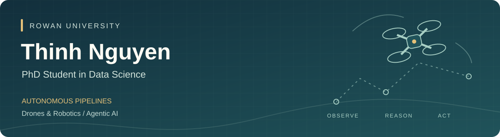

<a href="https://orcid.org/0009-0001-8537-4452">ORCID</a> · <a href="https://www.linkedin.com/in/thinhnguyen2004/">LinkedIn</a> · <a href="mailto:ngducthinh0501@gmail.com">Email</a> · <a href="PROJECTS.md">Project directory</a>

## About

I'm **Thinh Nguyen**, a **PhD student in Data Science at Rowan University**. My research focuses on **autonomous pipelines for drones and robots, and Agentic AI**.

I'm interested in how data, models and agents can work together across the full autonomy workflow—from observations and perception to planning, execution and evaluation. My earlier projects span applied machine learning, population health research and analytics.

## Research direction

| Area | Questions guiding my work |
| :--- | :--- |
| **Autonomous pipelines** | How can sensing, data processing, decision-making and execution form a reproducible workflow? |
| **Drones & robotics** | How can autonomous systems turn observations into useful actions in physical environments? |
| **Agentic AI** | How can agents coordinate tools and tasks, with clear evaluation and human oversight? |

These are my current research interests. The public projects below show the data science and engineering foundations I am building on.

## Selected public work

| Project | Focus | What to explore |
| :--- | :--- | :--- |
| **[FlightOps ML](https://github.com/thinhnguyen2026/flightops-ml)** | ML pipelines · In development | Flight-delay data ingestion, quality checks, provenance and chronological dataset splits. |
| **[Birth Outcomes Research](https://github.com/thinhnguyen2026/RESEARCH_BIRTH_OUTCOMES)** | Population health · Research | Analysis of 9M+ NCHS birth records, feature engineering and interpretable classification models. |
| **[Keeneland Auction Analysis](https://github.com/thinhnguyen2026/Keeneland-September-Yearling-Auction-Price-Predictive-Model-and-Buyer-Segmentation-Analysis)** | Predictive modeling | Auction-price prediction and buyer segmentation using 2020–2024 data. |
| **[Churn Prediction Dashboard](https://github.com/thinhnguyen2026/Churn-Predict-Dashboard)** | Applied ML · Explainability | A Streamlit application for customer churn prediction and model explanations. |

**Browse by theme:** [Research & ML systems](PROJECTS.md#research--ml-systems) · [Applied data science](PROJECTS.md#applied-data-science) · [Foundations & coursework](PROJECTS.md#foundations--coursework)

## Methods & tools

**Data & modeling:** Python · SQL · pandas · scikit-learn · PyTorch · TensorFlow  
**Research workflow:** Jupyter · Git · Linux · reproducible analysis  
**Visualization & analytics:** Matplotlib · Power BI · Tableau · Excel

## Connect

I'm interested in exchanging ideas about autonomous systems, robotics, Agentic AI and reproducible machine learning.

[Email](mailto:ngducthinh0501@gmail.com) · [LinkedIn](https://www.linkedin.com/in/thinhnguyen2004/) · [ORCID](https://orcid.org/0009-0001-8537-4452)
